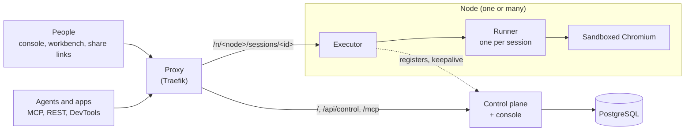

# Aperture

Aperture runs isolated Chromium sessions that people and agents watch and control together, and keeps what the sessions produce.

- **A session** is one browser with its own profile, files and network route, sandboxed on a node. It can be suspended and resumed, and its profile kept as a snapshot that later sessions start from, signed in where it was.
- **People** open a session in the console or by a link, and see and use it as a browser: tabs, address bar, clipboard, sound, files, recordings.
- **Agents** drive the same session over MCP, the REST API or the DevTools protocol. A person takes a tab from an agent at once.
- **Your own pages** embed a session with a React component or a custom element.

## The pieces



| Piece | What it does |
|---|---|
| Control plane | Accounts, workspaces, API tokens, sign-in, which node a session runs on, tickets and share links. Serves the console, the REST API at `/api/control` and MCP at `/mcp`. Needs PostgreSQL. |
| Node | A machine with an executor on it. The executor keeps the sessions' profiles and snapshots, starts a runner for each session and holds it to limits. |
| Proxy | One origin before the control plane and the nodes. It reads its routes from the control plane and asks it whether each request to a session may pass. |
| Console | The web app people sign in to: sessions, snapshots, workspaces, tokens, nodes, sign-in providers, events. |
| Workbench | A session shown as a browser to work in. The console shows it, a session serves it itself, and the npm packages embed it. |
| Companion | An extension for a browser of your own: it moves the tabs you choose, signed in as they are, into a session or a snapshot. [`extensions/aperture-companion`](extensions/aperture-companion) |

A runner also serves one session on its own, with no control plane and no executor: that is what the container image is.

## Status

Beta. v2 is a rewrite of Aperture and shares no API or protocol with v1: see [Upgrading from v1](docs/upgrading-from-v1.md).

Everything has one version: the programs, the image, the Nix packages and the npm packages move together, as `1.0.0-beta.N` until `1.0.0`. The first release is `1.0.0-beta.1`. [RELEASING.md](RELEASING.md) says what a release is made of.

## Quick start

On NixOS, one machine with everything on it is one option. With `github:tarik02/aperture/v<version>` as the flake input `aperture`:

```nix
{
  imports = [ aperture.nixosModules.default ];
  services.aperture.standalone.enable = true;
}
```

[Install](docs/install.md) carries that through to the first sign-in, TLS and a second node.

The pages below, with the packages and the REST API, are also a site: <https://aperture-browser-docs.pages.dev>.

| | |
|---|---|
| [Install](docs/install.md) | NixOS modules, Docker Compose, the container image, keys and tokens, first sign-in, TLS, nodes, data, health |
| [Configuration](docs/configuration.md) | Every setting an operator sets, with its type and default |
| [Monitoring](docs/monitoring.md) | Prometheus metrics of the control plane and the nodes, and what became of v1's |
| [Using](docs/using.md) | MCP for agents, the REST API, embedding a session, share links, the Companion extension |
| [Upgrading from v1](docs/upgrading-from-v1.md) | What changed, and the one-time migrator |
| [`skills/aperture`](skills/aperture/SKILL.md) | The workflows an agent follows, written for agents |
| [CONTEXT.md](CONTEXT.md) | What each word means here |

## Packages

Published to npm under `@aperture-browser`, with the dist-tag `beta` for a beta:

| Package | What it is |
|---|---|
| [`@aperture-browser/control-api`](packages/control-api) | The control plane's API as an Effect `HttpApi`, with a typed client |
| [`@aperture-browser/session-react`](packages/session-react) | React components: the workbench of one session, or its picture alone |
| [`@aperture-browser/session-element`](packages/session-element) | `<aperture-session>`, the same workbench as a custom element |
| [`@aperture-browser/session-client`](packages/session-client) | Framework-free client for one session: live protocol, picture, sound, input |
| [`@aperture-browser/executor-client`](packages/executor-client) | Effect client for one executor, for whoever runs nodes without a control plane |

The session's image is `ghcr.io/tarik02/aperture-session`; a deployment's are `ghcr.io/tarik02/aperture-control` and `ghcr.io/tarik02/aperture-node`, put together by [`deploy/compose.yaml`](deploy/compose.yaml).

## Licence

[MIT](LICENSE)
